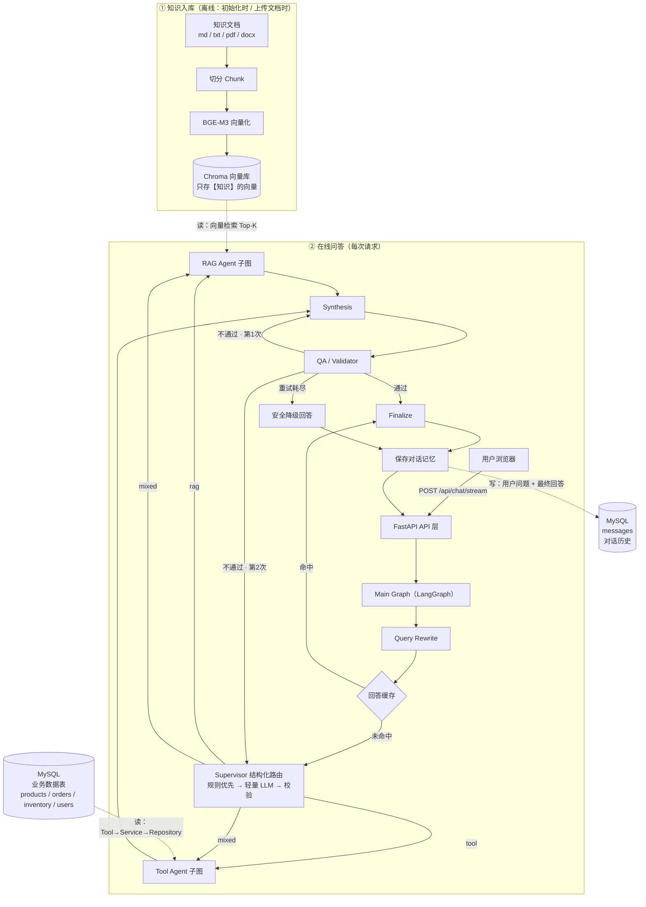

# 星辰数码商城智能客服工单处理系统

运行在 **Windows 本机、无 Docker、全进程本地运行** 的智能客服 Demo，
用 **LangGraph Multi-Agent** 把 RAG、Tool Calling、质检、溯源与流式输出串成一条
**可解释、可验证、可追溯** 的工程链路。

- 虚拟企业：**星辰数码商城**（数码配件电商）
- 本地模型：**Qwen3 8B**（LLM）+ **BGE-M3**（Embedding），通过 Ollama 运行
- 全流程：入库 → 检索 → 多 Agent 协作 → 质检 → 溯源 → Streaming → API → 前端

## 文档索引

| 文档 | 内容 |
| --- | --- |
| [`AI开发规范.md`](AI开发规范.md) | 开发约束与架构原则（AI Agent 编码规范） |
| [`docs/ARCHITECTURE.md`](docs/ARCHITECTURE.md) | 分层架构、主工作流、子图、数据模型、Streaming 事件 |
| [`docs/API.md`](docs/API.md) | 全部 API 端点、请求/响应示例、错误约定 |
| [`docs/METRICS.md`](docs/METRICS.md) | 指标定义与实测结果、Reranker 选型实测 |
| [`docs/INTERVIEW.md`](docs/INTERVIEW.md) | 项目亮点、设计决策、常见问答、扩展方向 |
| [`docs/TROUBLESHOOTING.md`](docs/TROUBLESHOOTING.md) | 26 个真实问题的现象/根因/解决/状态 + 负结论 |

## 功能特性

- **Multi-Agent 编排**：Supervisor（结构化路由 `{route, reason, tasks}`）→ RAG / Tool / Mixed → Synthesis → QA → 有限 Retry（`MAX_RETRY=2`）
- **Supervisor 分层路由**（模型职责重构）：**规则前置判定（0 次 LLM，毫秒级）** → 轻量提示词 LLM Router → 完整提示词复判 → 保守兜底；每级输出都过 schema + 任务完整性 + 一致性冲突校验（如输入含订单号却判 rag 则升级复判）。评测集 20 题中规则覆盖 17 题且**零误判**
- **QA 闭环可回退重规划**：QA 不通过 → 第 1 次带质检反馈重新合成 → 第 2 次**回 Supervisor 重新规划任务**重新取证 → 重试耗尽返回**安全降级回答**（不输出未过检草稿）。缓存只保存 **QA 通过的知识库（rag）回答**；订单、库存等 `tool` / `mixed` 回答不进缓存
- **企业知识库 RAG**：多格式入库（`md / markdown / txt / pdf / docx`）→ 切分 → BGE-M3 → Chroma（持久化 + `file_hash` 去重）
- **LLM 重排**：在线只用 Qwen3 8B 对向量候选排序（`LLMReranker`）。失败时保留召回顺序，RAG 不中断。曾比较过的 ONNX cross-encoder 已从代码和依赖里移除，选型记录见 [`docs/METRICS.md`](docs/METRICS.md)
- **可验证的检索**：baseline 与 optimized（Reranker）并存，测试集量化对比（**MRR 0.9 → 1.0**）
- **可靠的工具调用**：LLM Tool Calling，链路固定为 `Agent → Tool → queries → Repository → MySQL`，禁止 LLM 生成 SQL
- **多轮对话**：Query Rewrite 指代消解（"那运费谁承担？" → "星辰数码商城 K87 退货时的运费由谁承担？"）+ MySQL 会话记忆；会话列表按最近时间排序，支持**重命名 / 删除**
- **质检与溯源**：QA/Validator 结构化校验 + 有限重试；citation 可追踪到 `document_id / chunk_id / file_name`（前端按文档分组展示）
- **低延迟优化**：QA **规则先行**（结构可判定则不调 LLM）＋ **回答缓存**（相同问题 0 秒返回）
- **常见问题提示**：输入框上方的问题面板（**聚焦/点击输入框时才展示**，点选仅填入不发送）；`GET /api/faq` 为**静态数据**，不调 LLM / 不查库，对对话延迟零影响
- **流式输出**：SSE 只暴露用户可见事件（`status / tool / token / done`），内部事件不外泄
- **前端（无构建）**：原生 HTML/JS + 本地 vendor 的 Markdown 流式渲染、source card、工具状态、知识库管理页

---

## 1. 架构总览

> ⚠ 关键区分：**知识文档（md/txt/pdf/docx）只进 Chroma 向量库，不进 MySQL**；
> MySQL 只存**业务数据**（订单/商品/库存/用户）与**对话历史**。两个库职责不同、互补。



### 两个库分别存什么

| 存储 | 内容 | 写入方 | 读取方 |
| --- | --- | --- | --- |
| **Chroma**（`data/chroma/`） | 知识文档切分后的**向量 + metadata** | 知识入库（①，读 `data/documents/*`） | RAG Agent（**只读**） |
| **MySQL** · 业务表 | `products` / `orders` / `inventory` / `users` | `init_db` 种子脚本 | Tool Agent（**只读**） |
| **MySQL** · `messages` | 对话历史（“模型记忆”） | 保存对话记忆（**唯一写入**） | Conversation API（只读） |

`data/documents/*` 是**原始素材**（人写的、可读、可重新入库），它与 Chroma 是“原文 vs 派生索引”的关系；
知识文档**不会被写进 MySQL**。详见 [`docs/ARCHITECTURE.md`](docs/ARCHITECTURE.md)。

---

## 2. 技术栈

| 层 | 技术 |
| --- | --- |
| Web | FastAPI + Uvicorn（+ `python-multipart`） |
| Agent 编排 | LangGraph 1.x |
| LLM / Embedding | Ollama（`qwen3:8b` / `bge-m3`） |
| RAG | LangChain 1.x + Chroma + `pypdf` / `python-docx` |
| 业务数据 | SQLAlchemy 2.0 + PyMySQL + MySQL 8 |
| 前端 | 原生 HTML/CSS/JS + 本地 vendor（`marked` / `DOMPurify`），无构建步骤 |
| 配置 / 测试 | pydantic-settings / pytest（`slow` 标记） |

---

## 3. 目录结构

```text
app/
  main.py             FastAPI 入口（/health、/、/admin、/api、/static）
  config.py           集中配置（env 注入，含行为开关）
  application/        应用服务层（聊天、会话、知识库、推荐用例编排）
  db.py               SQLAlchemy 模型与连接（含 messages 表）
  repositories.py     数据访问层
  queries.py          业务数据查询（Tool 校验之后、Repository 之前）
  tools.py            业务工具（参数校验 + 错误兜底）
  memory.py           会话记忆（跨请求）
  streaming.py        用户可见事件流（SSE）
  seed.py             种子数据模型与加载
  evaluation.py       系统级评估（9 项指标）
  agents/
    supervisor.py     Supervisor 结构化路由
    rag_agent.py      RAG Agent 子图
    tool_agent.py     Tool Agent 子图（ReAct）
    business_tools.py 业务 Tool → LLM 暴露
    query_rewrite.py  多轮指代改写
    qa_agent.py       QA / Validator
    citation_align.py Citation 逐句归因（可选）
    main_graph.py     主图（编排 + 合成 + QA + Retry）
  rag/
    loaders.py        多格式文本提取（md/txt/pdf/docx）
    documents.py      加载 / 切分（metadata + 去重 hash）
    vectorstore.py    BGE-M3 + Chroma（入库 / 检索 / 去重）
    reranker.py       LLM-as-Reranker（Qwen3 候选片段排序）
    generation.py     Qwen3 生成
    pipeline.py       baseline / optimized 流水线
    evaluation.py     检索评估（Hit@N / MRR）
    management.py     文档管理（上传 / 列表 / 删除）
  api/                路由（chat / documents / conversations）+ schemas
  static/             前端页面（index / admin）+ vendor（marked / DOMPurify）
  scripts/            init_db / ingest_docs / evaluate / evaluate_system
data/
  seed/               业务种子数据（products/users/orders/...）
  documents/          知识库原始文档（md / markdown / txt / pdf / docx）
  eval/               测试问题集（20 题，覆盖 10 类）
  chroma/             向量库持久化（gitignore）
tests/                130 个测试（83 快速 + 47 slow）
```

---

## 4. 配置项

默认值在 [`app/config.py`](app/config.py)；`.env` 只需覆盖本机差异（尤其 `MYSQL_PASSWORD`）。完整可覆盖键见 [`.env.example`](.env.example)。

| 变量 | 默认 | 说明 |
| --- | --- | --- |
| `APP_NAME` / `LOG_LEVEL` | — | 应用名与日志级别 |
| `MYSQL_HOST` / `MYSQL_PORT` / `MYSQL_USER` / `MYSQL_PASSWORD` / `MYSQL_DB` | `127.0.0.1` / `3306` / `root` / 空 / `orl_dev` | 业务库与对话记忆库 |
| `OLLAMA_BASE_URL` | `http://127.0.0.1:11434` | 本地 Ollama 地址 |
| `OLLAMA_NUM_CTX` | `4096` | 上下文窗口（性能关键，详见 [METRICS.md](docs/METRICS.md)） |
| `OLLAMA_KEEP_ALIVE` | `30m` | 模型常驻时长，避免反复加载（单次加载 10–30s） |
| `OLLAMA_NUM_PREDICT` | `512` | 单次最大输出 token 数：**直接决定长文本生成的耗时上限** |
| `EMBEDDING_MODEL` / `LLM_MODEL` | `bge-m3` / `qwen3:8b` | 本地模型 |
| `CHROMA_PERSIST_DIR` / `CHROMA_COLLECTION` | `data/chroma` / `xingchen_knowledge` | 向量库持久化与集合名 |
| `RAG_TOP_K` | `4` | 评测基线向量召回条数（在线路径用下方 Rerank） |
| `CHUNK_SIZE` / `CHUNK_OVERLAP` | `500` / `50` | 切分参数 |
| `RERANK_TOP_K` / `RERANK_TOP_N` | `6` / `3` | 在线 RAG：向量候选数与重排后条数（已固化 LLM 重排） |
| `ROUTER_LLM_MODEL` | 空 | Router 专用模型，留空复用 `LLM_MODEL`；可指向更小模型进一步降延迟 |
| `ANSWER_CACHE_ENABLED` | `true` | 回答缓存（精确匹配：改写后问题 + 模型名） |

运行时已固化：Router=`auto`、mixed 串行、QA=`rule_first`、在线始终 LLM 重排。逐句归因仅离线评估 `--align`。

> 模板见 [`.env.example`](.env.example)；`.env` 已被 gitignore，**不要覆盖已有 `.env`**。

---

## 5. 快速开始（PowerShell）

```powershell
# 1. 安装依赖
uv sync

# 2. 配置环境变量：仅当 .env 不存在时从模板创建（不要覆盖已有 .env）
if (-not (Test-Path .env)) { Copy-Item .env.example .env }
# 然后编辑 .env，把 MYSQL_PASSWORD 改成你的 MySQL 密码

# 3. 初始化 MySQL（建库 + 建表 + 种子数据）
uv run python -m app.scripts.init_db

# 4. 构建知识库向量索引
uv run python -m app.scripts.ingest_docs

# 5. 启动服务
uv run uvicorn app.main:app --reload
```

访问：

- 客服 UI：<http://127.0.0.1:8000/>
- 管理后台：<http://127.0.0.1:8000/admin>
- API 文档：<http://127.0.0.1:8000/docs>
- 健康检查：<http://127.0.0.1:8000/health>

> ⚠ **必须通过服务器地址访问**（`http://127.0.0.1:8000/`），
> 不要直接用 `file://` 双击打开 `app/static/*.html`。
> 本地文件方式下浏览器会拦截接口调用，导致页面无法查询、发送无反应。

前置条件：本机已安装并运行 **Ollama**，且已拉取 `qwen3:8b` 与 `bge-m3`。

---

## 6. API 一览

| 方法 | 路径 | 说明 |
| --- | --- | --- |
| POST | `/api/chat` | 完整 Workflow，返回结构化结果 |
| POST | `/api/chat/stream` | SSE 流式（`status` / `tool` / `token` / `done`） |
| POST | `/api/documents` | 上传文档（`md` / `markdown` / `txt` / `pdf` / `docx`）并增量入库 |
| GET | `/api/documents` | 列出已入库文档 |
| PUT | `/api/documents/{id}` | 替换文档内容（修改；同名保持 `document_id`，内容未变化时幂等跳过） |
| DELETE | `/api/documents/{id}` | 删除文档（向量 + 无同名文档时的源文件） |
| GET | `/api/conversations` | 列出会话（按最近消息时间倒序，含标题） |
| GET | `/api/conversations/{id}` | 查看会话消息 |
| PATCH | `/api/conversations/{id}` | 重命名会话 |
| DELETE | `/api/conversations/{id}` | 删除会话及其全部消息 |
| POST | `/api/conversations/batch-delete` | 批量删除会话（全选删除） |
| GET | `/api/cache` | 回答缓存统计 |
| DELETE | `/api/cache` | 清空回答缓存 |
| GET | `/api/faq` | 常见问题列表（静态数据） |
| GET | `/health` | 健康检查 |

详见 [`docs/API.md`](docs/API.md)。

---

## 7. 测试

默认只运行**快速测试**（秒级）；涉及本地 LLM 的慢测试按需运行：

```powershell
uv run pytest                  # 快速测试（83 个，不调用 LLM）
uv run pytest -m slow          # 仅慢测试（LLM 相关）
uv run pytest --run-slow       # 全量（130 个）
```

| 分层 | 测试文件 |
| --- | --- |
| 数据 / 工具 | `test_phase02_data_consistency.py`、`test_tools.py`、`test_loaders.py` |
| RAG | `test_rag.py`、`test_rag_agent.py`、`test_rerank.py`、`test_reranker_pluggable.py` |
| Agent / 工作流 | `test_tool_agent.py`、`test_main_graph.py`、`test_e2e.py` |
| 可靠性 / 记忆 | `test_qa.py`、`test_qa_rules.py`、`test_qa_retry_loop.py`、`test_citation_align.py`、`test_memory.py`、`test_query_rewrite.py` |
| 评估 / 缓存 | `test_evaluation.py`、`test_cache.py`、`test_router_rules.py`、`test_product_clarify.py` |
| 接口 / 前端 | `test_api.py`、`test_frontend.py`（含 Node DOM 冒烟）、`test_streaming.py`、`test_health.py` |

---

## 8. 评估

```powershell
uv run python -m app.scripts.evaluate_system             # 全量测试集（20 题）
uv run python -m app.scripts.evaluate_system --limit 5   # 前 5 题
uv run python -m app.scripts.evaluate_system --ids q_rag_001,q_tool_001
uv run python -m app.scripts.evaluate_system --align     # 额外跑逐句归因（较慢）
```

指标：Routing Accuracy、Tool Calling Accuracy、Retrieval Hit Rate、Citation Accuracy、
**Citation Alignment Rate**、Answer Accuracy、QA Pass Rate、Retry Rate、Latency。
实测结果见 [`docs/METRICS.md`](docs/METRICS.md)。

RAG 检索另做 **Baseline vs Optimized（Rerank）** 对比：

```powershell
uv run python -m app.scripts.evaluate
```

---

## 9. 已知边界

已知边界（本机 RTX 4060 Laptop 8GB / 16GB 内存）：

- **单卡 GPU 推理串行**：`mixed` 并行实测无收益，故默认串行
- **逐句归因延迟高**：每题约 +100s，默认关闭，建议离线评估使用
- **未做真异步**：端点以同步为主，`mixed` 已可选并行；单卡下并发不会提升 LLM 吞吐
- **本地推理较慢**：单题约 2–4 分钟，全量评估耗时较长

---

## 10. 性能与延迟优化

单题延迟从 **189.2s → 28.2s（约 6.7×）**，核心优化为：显存驻留（`num_ctx` 降为 4096）、QA 规则先行（−28s）、输出长度限制、回答缓存（重复问题 0s）、规则优先路由（router 0ms）。

> 详细指标数据见 [docs/METRICS.md](docs/METRICS.md)；
> 问题排查记录见 [`docs/TROUBLESHOOTING.md`](docs/TROUBLESHOOTING.md)。

**进一步优化方向**（按性价比）：

1. ~~去掉单意图的二次生成~~ ✅ 已实现：单意图 RAG 跳过 synthesis（约 −30%）
2. Router 换更小模型（`ROUTER_LLM_MODEL=qwen3:0.6b`，无需改代码）
3. 换更小模型（`qwen3:4b`）→ 2–3×
4. ~~设 `OLLAMA_MAX_LOADED_MODELS=1`~~ ✅ 已配置
5. 引入 Memory 摘要（历史压缩）→ 长对话上下文有界
6. 知识库增大后复测 Reranker 效果
7. ~~品类模糊题 Tool 漏调~~ ✅ 已实现：纯品类短查询（如「键盘」）强制 `search_products`，多结果列选项澄清并跳过 synthesis
