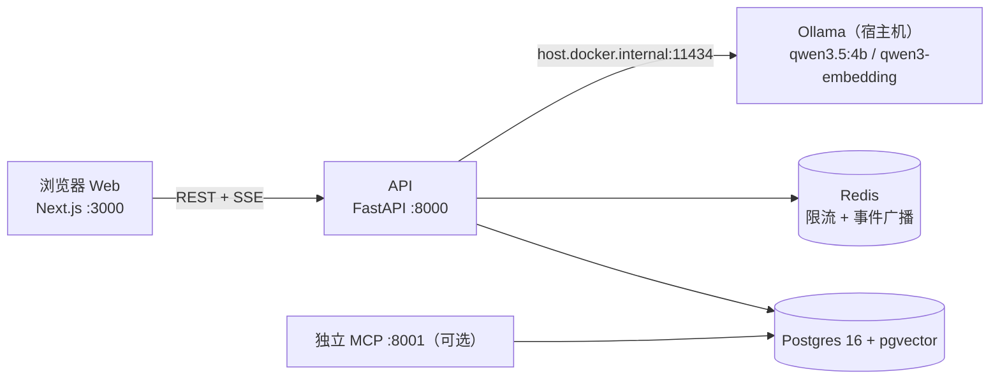

# ORL 智能客服工单

星辰数码商城的客服演示系统：机器人先答（RAG 检索 + 订单/库存工具调用），答不了或用户要求时自动建工单转人工，人工客服认领、回复、处理、结案。

## 架构总览



- 四个容器：`db` / `redis` / `api` / `web`，Ollama 留在宿主机，API 容器经 `host.docker.internal` 访问。
- 浏览器直连 API（`NEXT_PUBLIC_API_URL=http://127.0.0.1:8000` 构建期注入 web 镜像）。
- 独立 MCP 不进 Compose，给外部工具调用，查订单需带登录 JWT。

## 技术栈

| 层 | 选型 |
| --- | --- |
| API | FastAPI + SQLAlchemy 2.0 + psycopg3 |
| 检索 | pgvector（cosine，1024 维） |
| LLM | Ollama 本地模型（对话 + 嵌入） |
| 编排 | LangGraph（triage / resolve / ticket_fill） |
| 工具 | MCP SDK（进程内 + 独立 8001 双形态） |
| 前端 | Next.js 15 App Router + Ant Design 5 |
| 测试 | pytest，独立 `orl_test` 库 + 假模型注入 |

## 启动

本机需要已安装 Docker，并且 Ollama 已有 `qwen3-embedding:0.6b` 和 `qwen3.5:4b`。在仓库根目录构建并启动数据库、API 和网页：

```powershell
docker compose build
docker compose up -d
docker compose run --rm api uv run python -m app.scripts.ingest_docs
```

浏览器打开 `http://127.0.0.1:3000`。API 在 `http://127.0.0.1:8000`。改了 API 或知识库文档后需要重新 `docker compose build api`。

独立 MCP 不在 Compose 里。需要时在本机另开终端：

```powershell
cd apps/api
uv run python -m app.mcp_server
```

它监听 `http://127.0.0.1:8001`。查订单要带网页登录得到的 `Authorization: Bearer <JWT>`。

只想在本机跑 API 时，可以单独启动数据库：

```powershell
docker compose up -d db
cd apps/api
uv sync
uv run uvicorn app.main:app --port 8000
```

另开一个终端，把知识库写入向量库：

```powershell
cd apps/api
uv run python -m app.scripts.ingest_docs
```

演示账号密码都是 `demo1234`：`user1` 是顾客，`agent1` 是人工客服。顾客张三的手机号是 `13800001111`，名下有键盘订单 `ORD12345678` 和鼠标订单 `ORD12345679`。

## 演示

下面的命令在仓库根目录执行。`POST /api/chat` 返回完整 JSON。`POST /api/chat/stream` 用 SSE 推送，最后一条 `done.final_answer` 才是要展示的文本。

```powershell
$login = curl.exe -s http://127.0.0.1:8000/api/auth/login -H "Content-Type: application/json" -d "{\"username\":\"user1\",\"password\":\"demo1234\"}"
$token = ($login | ConvertFrom-Json).access_token
$auth = @{ Authorization = "Bearer $token" }

$conv = curl.exe -s http://127.0.0.1:8000/api/conversations -H "Authorization: Bearer $token" -H "Content-Type: application/json" -d "{}"
$cid = ($conv | ConvertFrom-Json).conversation_id

curl.exe -N http://127.0.0.1:8000/api/chat/stream -H "Authorization: Bearer $token" -H "Content-Type: application/json" -d "{\"conversation_id\":\"$cid\",\"message\":\"我的订单到哪了\"}"

curl.exe -s http://127.0.0.1:8000/api/chat -H "Authorization: Bearer $token" -H "Content-Type: application/json" -d "{\"conversation_id\":\"$cid\",\"message\":\"转人工\"}"
```

转人工响应里的 `ticket_id` 交给人工客服：

```powershell
$agentLogin = curl.exe -s http://127.0.0.1:8000/api/auth/login -H "Content-Type: application/json" -d "{\"username\":\"agent1\",\"password\":\"demo1234\"}"
$agent = ($agentLogin | ConvertFrom-Json).access_token

curl.exe -s http://127.0.0.1:8000/api/tickets?status=open -H "Authorization: Bearer $agent"
curl.exe -s -X POST http://127.0.0.1:8000/api/tickets/TICKET_ID/claim -H "Authorization: Bearer $agent"
curl.exe -s -X POST http://127.0.0.1:8000/api/tickets/TICKET_ID/messages -H "Authorization: Bearer $agent" -H "Content-Type: application/json" -d "{\"content\":\"已为您处理\"}"
curl.exe -s -X POST http://127.0.0.1:8000/api/tickets/TICKET_ID/transition -H "Authorization: Bearer $agent" -H "Content-Type: application/json" -d "{\"action\":\"resolve\"}"
curl.exe -s -X POST http://127.0.0.1:8000/api/tickets/TICKET_ID/transition -H "Authorization: Bearer $agent" -H "Content-Type: application/json" -d "{\"action\":\"close\"}"
```

把 `TICKET_ID` 换成转人工返回的工单号。健康检查是 `curl.exe http://127.0.0.1:8000/health`。

## API 一览

| 方法 + 路径 | 说明 | 权限 |
| --- | --- | --- |
| `POST /api/auth/login` | 登录，返回 JWT + role | 公开 |
| `POST /api/conversations` | 新建会话 | 顾客 |
| `GET /api/conversations/me` | 我的会话列表（含预览） | 顾客 |
| `GET /api/conversations/{id}` | 会话消息记录 | 本人 |
| `POST /api/chat` | 聊天，一次返回完整 JSON | 顾客 |
| `POST /api/chat/stream` | 聊天，SSE 流式（meta/status/token/reset/done） | 顾客 |
| `GET /api/tickets?status=` | 工单列表（按优先级排序） | 坐席 |
| `GET /api/tickets/events` | 工单变更事件流（SSE） | 坐席 |
| `GET /api/tickets/{id}` | 工单详情（消息/事件/顾客档案） | 坐席 |
| `POST /api/tickets/{id}/claim` | 认领工单（并发安全） | 坐席 |
| `POST /api/tickets/{id}/messages` | 坐席回复 | 认领人 |
| `POST /api/tickets/{id}/transition` | resolve / close / cancel | 坐席 |
| `GET /health` | 健康检查 | 公开 |

## 测试

```powershell
cd apps/api
uv run pytest -q
```

61 个用例全部通过。测试只连 `orl_test` 库（不存在会自动创建），假模型注入代替 Ollama，无需网络。

## 目录结构

```
ORL/
├── apps/api/          # FastAPI：路由、服务层、LangGraph、MCP、测试
├── apps/web/          # Next.js：登录 / 顾客聊天 / 坐席台
├── data/documents/    # RAG 政策语料（markdown）
├── docker-compose.yml # db / redis / api / web
└── README.md          # 本文件
```
