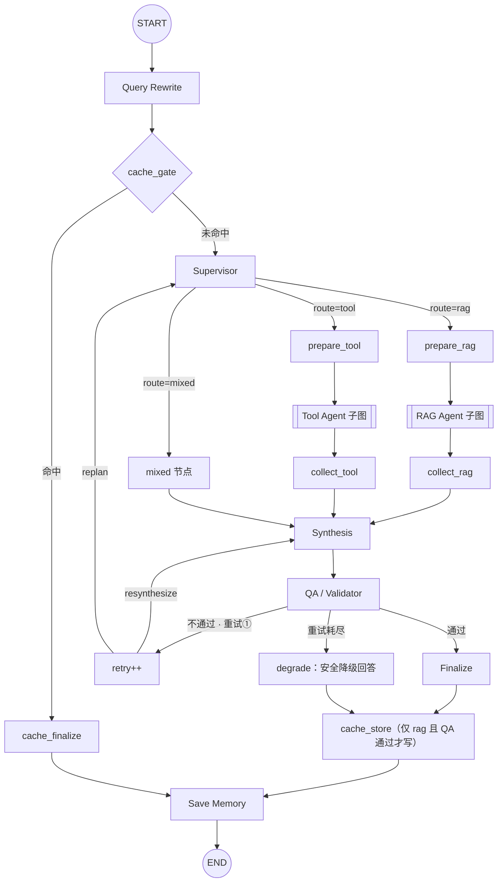

# 架构设计

星辰数码商城智能客服系统 —— 分层架构与多 Agent 工作流。

## 1. 整体分层

```text
前端 (HTML/JS + Markdown 流式渲染)
   │  HTTP / SSE
   ▼
API 层 (FastAPI)              —— 只做 HTTP / SSE 协议转换
   │
   ▼
应用服务层 (Chat / Conversation / Knowledge / Suggestion)
   │
   ▼
Workflow 层 (LangGraph Main Graph)
   │
   ▼
Agent 层 (Supervisor / RAG / Tool / QA)
   │
   ▼
能力层 (RAG Pipeline / Business Tools / Memory)
   │
   ▼
数据层 (Chroma 向量库 / MySQL) —— Tool → queries → Repository → MySQL
```

### 核心原则

- API 层不含业务逻辑：`API → application → Graph / RAG / Tool`
- 业务数据访问必须走 `Agent → Tool → queries → Repository → MySQL`，禁止 `Agent → SQL → MySQL`
- Workflow State（单次请求）与 Conversation Memory（跨请求）严格分离
- 知识文档只进 Chroma；MySQL 只存业务数据与对话历史

## 2. 主工作流（LangGraph）



> `route=rag` / `route=tool` 走**原生 LangGraph 子图节点**；
> `route=mixed` 走独立的 `mixed` 节点（节点内串行或并发调用两个子图）。

### 2.1 Supervisor（分层路由：规则 → 轻量 LLM → 校验升级）

Supervisor 是**架构角色**（工作流控制与任务路由），不是某个具体模型。

- 职责：理解请求 → 判断任务类型（rag / tool / mixed）→ 生成结构化路由 `{route, reason, tasks}`
- 不直接回答、不访问 MySQL/Chroma、不执行 SQL/检索/Tool
- 决策链（已固化）：
  1. **RulePreCheck**（0 次 LLM，毫秒级）：实体正则（`ORD\d{6,}` / `P\d{3}` / `U\d{3,4}`）+ 政策词 + 业务查询词 → 直接路由
  2. **Lightweight Router**：精简提示词 + `with_structured_output`
  3. **Full Prompt 复判**：完整提示词再判一次
  4. **Fallback**：保守默认 rag（路由永不失败）
- **每级输出都过校验**：schema validation（pydantic）→ 任务完整性（mixed 必须双任务、query 非空）→ **一致性冲突检测**（输入含订单号却判 rag、含政策意图却判 tool 则升级复判）
- `decision_path`（`rules` / `llm_short` / `llm_full` / `fallback`）回写 state，供分析与 profiling
- 重规划入口：QA 二次失败时带 `qa_feedback` 重新调用 Supervisor 规划任务（此时跳过规则直判）

### 2.1.1 QA 闭环（Answer → QA → PASS / FAIL → 重规划）

| 情形 | 动作 |
| --- | --- |
| QA 通过 | `finalize` → `cache_store`（**仅通过才写缓存**）→ Save Memory |
| QA 不通过（重试①） | 带质检反馈回 `synthesis` 重新合成 |
| QA 不通过（重试②） | 回 **Supervisor 重新规划**（清空旧证据 `rag_result` / `tool_result` / `citations` / `tool_calls`）→ 重跑子图 → 合成 → QA |
| 重试耗尽（`MAX_RETRY=2`） | `degrade`：返回**安全降级回答**（致歉 + 建议转人工），**不输出未过检草稿**，且不写缓存 |

### 2.2 RAG Agent 子图

```text
START → retrieve(BGE-M3 → Chroma Top-K) → generate(Qwen3) → END
输入: query     输出: answer + sources
```

### 2.3 Tool Agent 子图（ReAct）

```text
START → init → agent ⇄ execute_tools → finalize → END
输入: query     输出: answer + tool_calls
```

LLM 通过 Tool Calling 选择业务工具并生成参数；工具链路：

```text
Agent → Tool → queries → Repository → SQLAlchemy → MySQL
```

### 2.4 mixed 节点（RAG ∥ Tool）

- RAG 与 Tool **互不依赖**，在 `mixed_node` 内**串行**执行
- 为何不用图级 fan-out：两个子图都读取 state key `query`，并行会产生**键冲突**
- 曾尝试 `ThreadPoolExecutor` 并行：单卡 GPU 上 Ollama 推理本身串行，实测无收益甚至更慢，故已固化串行

### 2.4.1 Reranker（LLM-as-Reranker）

统一协议 `Reranker.rerank(query, documents, top_n)`，线上唯一实现为
`LLMReranker`：Qwen3 8B 对向量召回候选进行结构化排序。它在本项目中文商城
知识库的评测中优于 ONNX cross-encoder，因此不再维护额外的 reranker 模型、
下载依赖或回退分支。

- 在线链路已固化：向量 Top-K → LLM 排序 → Top-N
- 片段输入最多 800 字符，降低尾部关键信息被截断的概率
- 热模型实测（2026-09-21，本机 Ollama）：向量检索约 0.03s，加上 LLM 重排约 0.8s。相对后面数秒的生成，重排不是主延迟

### 2.4.2 Latency Profiling

- `app/profiling.py` 基于 `contextvars` 提供阶段计时：`precheck` / `router` / `rewrite` / `cache_lookup` / `embedding` / `retrieval` / `reranker` / `rag_gen` / `tool_llm` / `tool_exec` / `synthesis` / `qa` / `qa_llm`
- 无 Profiler 时所有埋点为 **no-op**，对既有单测与离线脚本零影响
- 输出位置：`run_main_graph()` 返回 `profile`、`/api/chat` 响应字段、SSE `done` 事件、`evaluate_system` 聚合（avg / P95）
- 专项脚本：`uv run python -m app.scripts.profile_latency`（结果存档 `data/profiling/<label>.json`）

### 2.5 Synthesis

- 用 Qwen3 把 RAG / Tool 的结果**合成**为完整、自然的最终回答
- 重试时带上 QA 的 `issues` 作为反馈，要求修正后重新生成
- 合成使用一次性 `invoke`。同一提示下 `stream` 的首个可见 token 也要约 7s（模型先思考，答案在末尾一次性吐出），改成流式不能提前出字

### 2.6 QA / Validator

- 检查：是否回答用户问题、是否事实错误、是否与上下文冲突、是否编造、引用是否有效
- 输出 `{passed, issues, citation_valid, reason}`
- 可选**逐句归因**（仅离线 `evaluate_system --align`），见 §4
- **QA 不负责路由**：它只判定回答可靠性；不通过时由 retry/replan 回到 Synthesis 或 Supervisor

### 2.7 有限 Retry

- 不通过则带着 `issues` 回到 Synthesis 重试，`MAX_RETRY=2` 禁止无限循环
- LangGraph `recursion_limit` 作为兜底

### 2.8 QA 规则先行 与 回答缓存

两者都是为了降低单题延迟（实测：LLM 质检占 33s/18%）。

**QA 规则先行**（已固化）：

```text
规则硬失败（空答 / 缺溯源 / 未调工具） → 直接 passed=false（0 次 LLM）
规则快速通过（结构完整 + 词面一致）    → 直接 passed=true（0 次 LLM）
其余（词面重合度过低，疑似编造）      → 交 LLM 复核
```

质检结果带 `checked_by` 字段（`rule` / `llm` / `fallback`），便于观测。

**回答缓存**：

```text
rewrite → cache_gate ──hit──→ cache_finalize → save_memory → END
                      └miss─→ supervisor → … → finalize → cache_store → save_memory → END
```

- 键 = `hash(模型名 + 归一化问题)`；换模型天然失效
- 只缓存 `route=rag` 且 QA 通过的回答。`tool` / `mixed` 含订单或库存，不写入；读到旧的非 rag 缓存视为未命中
- 知识库变更（上传/删除文档）→ `management` 调用 `cache.clear()`
- 命中时不调用任何 LLM，直接恢复 `route / final_answer / citations / qa_result`

### 2.9 推理参数集中管理（性能关键）

所有 LLM 统一由 `app/llm.py::get_chat_model()` 构造，集中控制参数：

| 参数 | 默认 | 为何重要 |
| --- | --- | --- |
| `num_ctx` | **4096** | Ollama 对 qwen3 默认 32768，KV cache 约 4.8GB；8GB 显卡装不下 8B 模型 → 层被卸载到 CPU → **慢数倍** |
| `num_predict` | **512** | 单次最大输出 token 数；配合 prompt「简明扼要」把回答从 ~700 字压到 ~200 字 |
| `keep_alive` | `30m` | 避免模型反复加载（单次加载 10–30s） |
| `temperature` | `0` | 客服回答需稳定可复现 |

实测：`num_ctx` 从 32768 降到 4096 后，`qwen3`(5.58GB) + `bge-m3`(0.66GB) **100% 驻留显存**，
mixed 路由 **205.8s → 47.5s**。验证方式：`nvidia-smi` 与 `curl http://127.0.0.1:11434/api/ps`（看 `size_vram`）。

### 2.10 模型职责边界与结构化输出

#### 角色边界

| 角色 | 职责 | 明确不做的事 |
| --- | --- | --- |
| Supervisor | 路由决策（rag / tool / mixed）+ 重规划 | 不直接回答用户、不访问 MySQL/Chroma、不执行检索或工具 |
| RAG Agent | 知识库检索 + 生成回答 | 不访问 MySQL、不做路由决策 |
| Tool Agent | 业务数据查询（ReAct + Tool Calling） | 不检索知识库、不做路由决策 |
| QA | 回答质量验证（事实性、引用有效性） | 不负责路由、不生成回答、不重写答案 |

所有角色共用同一个底层模型（Qwen3 8B），通过**提示词与工具绑定**区分行为，而非多模型部署。

#### `get_structured_model()` 与 `reasoning=False`

Qwen3 是**思考型模型**（thinking model），生成时会先产出内部思考 token，这些 token **同样计入 `num_predict` 预算**。

结构化判定类调用（路由、重排、质检、逐句归因）使用 `get_structured_model()`，默认 `reasoning=False` 关闭思考：

- **为什么必须关闭**：长提示（如 6 个候选片段的重排提示）下，思考 token 会吃满 512 token 预算，导致 `done_reason=length` 且可见输出为空，`with_structured_output` 抛出 `OutputParserException`
- **关闭后的效果**：重排从超时失败 → 0.7s 完成；路由从 6.1s → 1.1s 且不再失败
- **`num_predict=128`**：结构化输出通常仅需 ~50 tokens，128 足够且节省推理时间
- **生成类调用保留思考**：RAG 生成、Synthesis、Query Rewrite 使用 `get_chat_model()`，默认开启思考以保证回答质量

## 3. RAG Pipeline

### 3.1 文档加载（多格式）

```text
md / markdown / txt / pdf / docx
   │  app/rag/loaders.py（PDF 按页提取，其余单页）
   ▼
Document（带 document_id / file_hash / page metadata）
```

- 纯文本：utf-8 优先，兼容 gbk
- PDF：`pypdf` 按页提取（`page` 为真实页码）
- docx：`python-docx` 提取段落
- 入库前按 `file_hash` 去重，避免重复向量

### 3.2 Baseline（Phase 04）

```text
Document → Chunk → BGE-M3 → Chroma → Retrieval → Qwen3
```

### 3.3 Optimized（Phase 10）

```text
Query → BGE-M3 → Chroma Top-K → Reranker(Qwen3) → Top-N → Qwen3
```

保留 baseline 与 optimized 两版用于对比（`app/rag/evaluation.py`）。

## 4. QA 逐句归因（可选）

`app/agents/citation_align.py`：

```text
回答 → 切句（剥离 Markdown 噪声） → 逐句回溯上下文 → unsupported_sentences
```

- 输出 `{sentences, unsupported_indices, unsupported_sentences, supported_ratio}`
- 集成到 QA：写入 `qa_result.unsupported_sentences / supported_ratio`；有则 `passed=false` 并追加 `issues`
- **默认关闭**：每题约 +100s（279.2s vs ~180s），评估时用 `--align` 开启

## 5. 数据模型

### 5.1 MySQL

| 表 | 说明 |
| --- | --- |
| products | 商品 |
| users | 用户 |
| inventory | 库存 |
| orders | 订单 |
| order_items | 订单明细 |
| messages | 会话记忆（Phase 09，按 `conversation_id` 索引） |
| conversations | 会话元信息（标题，支持重命名 / 删除） |
| answer_cache | 回答缓存（模型名 + 改写后问题 → 结果，命中即跳过 LLM） |

### 5.2 Chroma metadata（可溯源）

```json
{
  "document_id": "doc_xxx",
  "file_name": "售后与退换货.md",
  "version": 1,
  "chunk_id": "doc_xxx_chunk_000",
  "page": 1,
  "source": "售后与退换货.md",
  "file_hash": "..."
}
```

`file_hash` 用于去重；`document_id` / `chunk_id` 保证可追踪到原始片段。

## 6. Streaming 事件协议

内部 LangGraph 事件与用户可见事件分离（`app/streaming.py`）：

| type | 含义 |
| --- | --- |
| `meta` | 会话 ID |
| `status` | 用户可见状态（分析问题 / 检索知识库 / 查询业务数据 / 生成回答 / 验证回答） |
| `tool` | 工具调用（name + args） |
| `token` | 最终回答的 token 流（前端增量渲染 Markdown） |
| `done` | 完成（final_answer + citations + qa_passed + retry_count） |

内部节点（`prepare_*` / `collect_*` / `retry` 等）**不暴露**给前端。

前端展示约定：

- `token` 流式片段经 **Markdown 增量渲染**（60ms 节流），并在完成时校正为完整 Markdown
- `citations` 为**片段级**，前端按 `document_id` **分组**为「一篇文档一张卡片 + chunk 列表」

## 7. 错误处理

- 领域异常分层：`ValidationError`（400）/ `NotFoundError`（404）/ `DatabaseError`
- Tool 统一处理：参数缺失、参数非法、数据不存在、数据库异常、空结果
- 禁止 `except Exception: pass`

## 8. 关键配置

| 配置 | 默认 | 作用 |
| --- | --- | --- |
| `RAG_TOP_K` | `4` | 评测基线向量召回条数 |
| `RERANK_TOP_K` / `RERANK_TOP_N` | `6` / `3` | 在线 RAG：候选数与重排后条数 |
| `CHUNK_SIZE` / `CHUNK_OVERLAP` | `500` / `50` | 文档切分参数 |
| `ROUTER_LLM_MODEL` | 空 | Router 专用模型（空则复用主模型） |
| `ANSWER_CACHE_ENABLED` | `true` | 回答缓存 |

运行时已固化：Router 分层升级、mixed 串行、QA 规则先行、在线始终 LLM 重排。逐句归因仅 `--align`。
